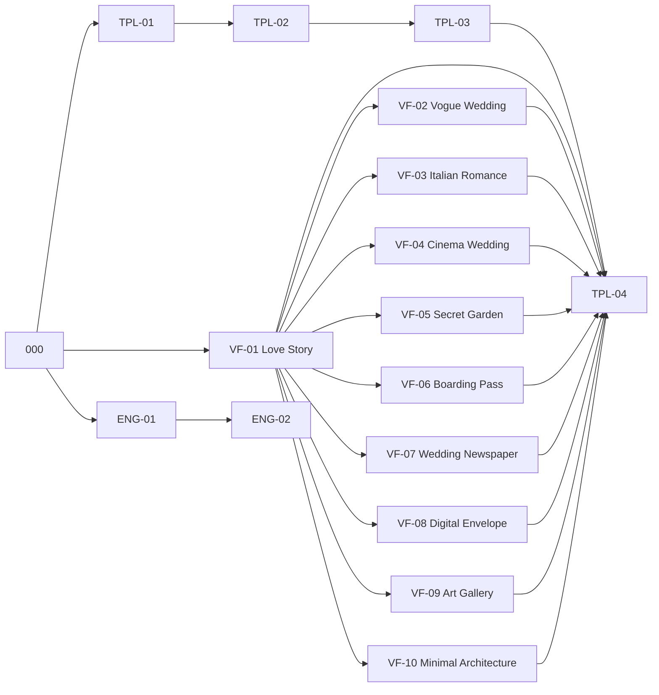
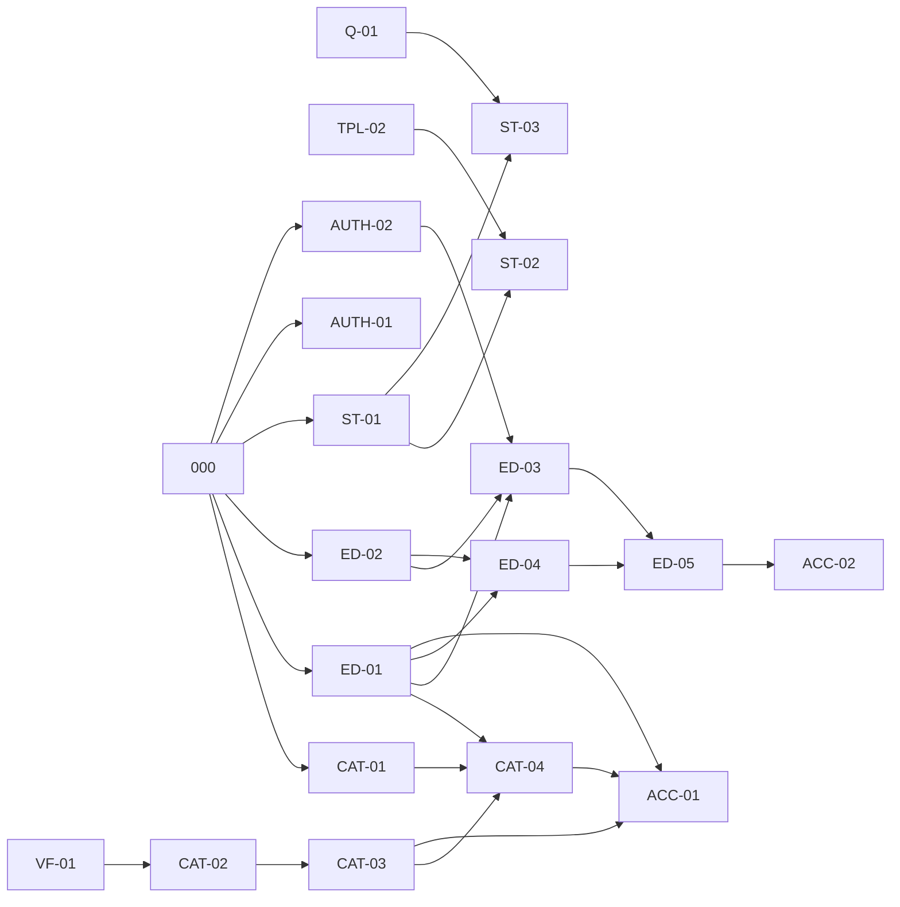
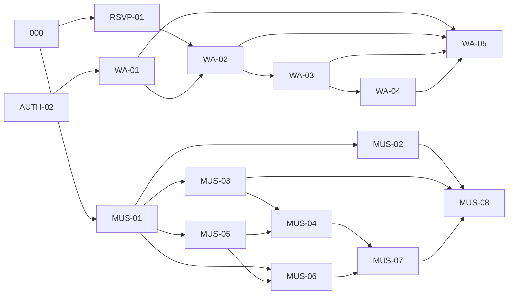
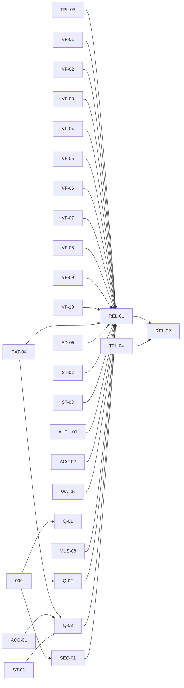

# Eventiq 4.1 — мастер-план

**База TASK 000** — [`origin/main` на 4afec94c66b7d3d5cdc49994731fefd3346b0e6d](https://github.com/akkunov/invito/commit/4afec94c66b7d3d5cdc49994731fefd3346b0e6d), проверено 24 ноября 2026. [PR #79](https://github.com/akkunov/invito/pull/79) объединил 4.0 с `main`. Дерево файлов на базовом SHA совпадает с `e3dfe4d`. Статус выкладки и рабочей БД не выводится из Git.

4.1 продолжает [аудит](REFACTOR-AUDIT.md), [план 4.0](REFACTOR-PLAN.md) и [отчёт 4.0](EVENTIQ-4-REPORT.md). Текущие доказательства и следующие действия ведём в [реестре](PROJECT-STATUS.md); принятые и предложенные решения — в [журнале решений](DECISIONS.md). [docs/ARCHITECTURE.md](../ARCHITECTURE.md) описывает ранний прототип. При расхождениях проверяем текущий код и явно фиксируем поправку в реестре.

## Карта проекта

| Область | Точки входа | Канонические модули и данные |
| --- | --- | --- |
| Витрина RU/KY | `/[locale]`, `/templates`, `/templates/[slug]`, `/catalog/[slug]` с тем же префиксом локали | `src/app`, legacy `seed-templates`, `src/features/invitations/server-catalog.ts`, Nest `CatalogService`. `/catalog` ведёт на канонический индекс `/templates`. |
| Клиентское редактирование | `/[locale]/editor?template=…&draft=…` | Seed и cloud используют свои адаптеры, а на мобильных общий `UniversalMobileEditor`. Облачная версия редактируется по `PersonalizationContract`, снимок отображает `StudioV2ProjectRenderer`. Локальное состояние живёт в браузере, черновик владельца в PostgreSQL. |
| Авторизация и кабинет | `/[locale]/auth/callback`, `/account`, `/invitations` | Supabase PKCE и `use-customer-session.ts`, Nest JWT/AuthIdentity. `GET /api/v1/customer/account/overview` агрегирует список и RSVP для владельца. |
| Admin Studio v2 | `/[locale]/admin/studio-v2`; сохранился `/admin/studio` | `src/components/studio-v2`, типизированные команды, геометрия страниц, слои, адаптивные правила, история. Template Manager ведёт локальный реестр и открывает копии из облачного списка; API версий и публикации отделены. |
| Общие контракты | `src/features/studio-v2/core`, `server/domain/persistence-contract.ts` | Строгие Zod-контракты для документа, разрешений, гостевых виджетов и снапшотов. Next и Nest используют общие правила вокруг своих точек входа. |
| Публичные приглашения и RSVP | `/[locale]/c/[slug]` (клиентские), `/[locale]/i/[slug]` (Studio) | `CustomerPublicationRelease`/`CustomerRsvpResponse` и `PublicationRelease`/`RsvpResponse` — существующие отдельные контуры. Рендер читается из опубликованного снапшота, правила принятия RSVP включают проверку активного релиза, идемпотентность и защиту от злоупотреблений. |
| API и хранение | `server/src/app.module.ts`, `server/src/openapi.ts` | Nest модули Auth, Workspaces, Documents, Catalog, Media, Publications, CustomerInvitations. Prisma/PostgreSQL для владельцев, версий, черновиков, гостевых релизов и ответов. R2 для verified media; загрузка и чтение используют ограниченные подписанные ссылки. |
| Коллекция | `templates/packages`, `templates/collection`, `scripts/compile-template-collection.mjs` | 20 проверенных пакетов, включая 10 новых дизайнов; handoff и оригиналы отдельно в `tamplates_codex/eventiq-10-templates-codex`. Исходный blueprint отличается от импортируемого пакета. [Коллекция](../studio-v2/TEMPLATE-COLLECTION.md) |

Ядро стека по lockfiles — Next.js 16.4.6, React 19.3.1, NestJS 12.5.1, Prisma 7.10.1, Zod 4.6.7, Supabase SSR 0.7.0. Проект имеет два npm lockfile. Backend требует Node.js ≥22.18.0; workflows используют Node 22. [Frontend manifest](../../package.json) · [Backend manifest](../../server/package.json) · [Prisma schema](../../server/prisma/schema.prisma)

### Версии и миграции

Семь миграций идут от начальной схемы, публикаций и RSVP через customer drafts, customer publications, customer RSVP и wishes к `20261124010000_pin_catalog_template_version`. Последняя добавляет `Template.publishedVersionId`, дополняет видимые опубликованные записи и проверяет принадлежность версии шаблону составной связью. Добавление новой версии меняет авторский head. Публичный указатель переводится отдельной операцией. Существующему черновику нужен его первоначальный `templateVersionId`, включая браузерное открытие. Гостевые URL ведут на самостоятельные release snapshots. [Миграции](../../server/prisma/migrations) · [Протокол публикации каталога](../backend/SERVER-TEMPLATE-CATALOG.md)

## Порядок работ и критерии по направлениям

| Направление | Порядок и ожидаемый результат |
| --- | --- |
| Эталон и универсальный движок | Начать с VF-01 Love Story. Проверить общий renderer и данные в сопоставимых условиях. Узкое отклонение исправить на уровне исходных ресурсов или новой версии пакета. Повторяющийся пробел движка вынести в ENG-01/02 с доказательством. Девять следующих задач используют эталон и заканчиваются отдельной приёмкой. |
| Десять существующих шаблонов | TPL-01 инвентаризирует identity. TPL-02 реализует безопасный update, TPL-03 репетирует повторы и CAS на отдельной БД. TPL-04 выпускает только согласованные версии после визуальной приёмки и явного разрешения. |
| Каталог на 100+ | CAT-01 нормализует DTO, сливает результаты без неоднозначной подмены источника, сохраняет цену и URL. CAT-02 и CAT-03 вводят детерминированные версионные обложки, асинхронную генерацию, хранение и backfill. CAT-04 интегрирует общий компонент списка, detail и выбор шаблона, проверяет различия legacy/cloud. |
| Клиентский редактор | ED-01 читает исходную версию черновика. ED-02 разделяет локальные ключи. ED-03 упорядочивает autosave, refresh медиа и конфликты. ED-04 переносит утверждённый shell на desktop и сохраняет рабочий mobile. ED-05 закрывает обзор, публикацию, навигацию секций и совместимость. |
| Admin Studio v2 и Template Manager | ST-01 фиксирует границы авторинга и воспроизводимые сценарии. ST-02 расширяет облачные действия над выделенным шаблоном через существующий API. ST-03 проверяет устойчивость canvas и реестра на больших проектах. |
| Google OAuth и кабинет | AUTH-01 проверяет реальный Google в тестовом Supabase. AUTH-02 проверяет жизненный цикл сессии и изоляцию состояния. ACC-01 добавляет версионные миниатюры. ACC-02 доводит share и QR с действующими ссылками и правами. |
| RSVP и WhatsApp Cloud API | RSVP-01 стабилизирует оба существующих гостевых потока. WA-01…05 покрывают подтверждённый контакт и opt-in, outbox в транзакции RSVP, worker, webhook и живую проверку WABA. Сбой уведомления не ухудшает приём RSVP. |
| Музыка | MUS-01…08 покрывают адаптер текущих источников, права/модерацию, серверный поиск, библиотеку, общий плеер, обратно совместимые настройки фрагмента и реальную проверку устройств. Audius — первый внешний кандидат. Jamendo и Openverse подключаются через тот же интерфейс после отдельного подтверждения условий. |
| Качество и выпуск | Q-01 восстанавливает статическое превью Studio, Q-02 устраняет существующий lint debt по модулям, Q-03 измеряет работу на 100+ шаблонах. SEC-01 закрывает найденные риски. REL-01 проводит интеграционную репетицию, REL-02 фиксирует готовность и управляемый rollout. |

Граф ниже показывает зависимости задач. Стрелка ведёт от необходимого результата к следующей задаче. В одной ветви можно делать независимые проверки параллельно, сохраняя назначенный порядок приёмки. `BLOCKED` означает внешний барьер, остальные незакрытые зависимости отражаются в `TODO`. Полный список с SHA и доказательствами — в [PROJECT-STATUS.md](PROJECT-STATUS.md).

### Визуальный эталон и данные

### Каталог, редактор и авторинг

### Гостевые формы и внешние интеграции

### Качество, безопасность и выпуск

## Протокол Visual Fidelity

1. **Источник.** Для каждого шаблона определить по `templates-index.json` оригинальные четыре PNG, `geometry.json`, спецификацию и отдельные медиа. Работать с копией fixture из пакета или разрешённого экспортированного снимка. Воспроизводимость записать с базовым SHA, версией пакета, браузером и версиями шрифтов. Документация первоначального импорта и её скриншоты — исходные данные для сравнения. [Исходные материалы](../../tamplates_codex/eventiq-10-templates-codex) · [Правила коллекции](../../tamplates_codex/eventiq-10-templates-codex/design/COMMON-IMPLEMENTATION.md)
2. **Одинаковые условия.** Снять реальный гостевой рендер каждого артборда в его исходных CSS px при DPR 1, с viewport точного размера PNG этого артборда. Записать размер PNG и скриншота. Если живая секция выше исходника, отдельно показать всю секцию и зафиксировать отличие; не обрезать его из отчёта. Загружать шрифты и картинки до снимка; использовать синтетические данные, замороженный таймер, фиксированную локаль и указанную фазу анимации/раскрытия. Для точного сравнения оригинала выставить исходные текст и состояние. KY проверять отдельно с корректным содержимым и реальной раскладкой.
3. **Артефакты.** Для 01–04 положить тройку `reference`, `render`, `diff` одинакового размера. Ссылки на оригинал в Git допустимы. Зафиксировать команду capture, регион сравнения, инструмент и параметры diff, снимки реальных интерактивных состояний. Не масштабировать различия и не заменять реальные слои скриншотом. Числовая метрика служит дополнением к проверке композиции, формы, фото, текста и состояний. Допуски согласуются по конкретному элементу.
4. **Адаптация.** Помимо сравнения исходных размеров проверить 320×568, 360×800, 375×812, 390×844, 412×915, 430×932 и desktop при наличии соответствующего режима. Проверить RU/KY, длинные имена, шрифт, текстовые и фото-замены, фокус/клавиатуру, touch, reduced motion и ошибки интерактивных блоков. Гостевой canvas занимает доступную ширину, живые формы используют нативный масштаб.
5. **Выпуск.** Ревьюер визуально подписывает конкретную пару «источник и версия рендера» и допустимые отклонения. При обходном пути или отсутствии оригинальных медиа фиксирует конкретный пробел. Автоматические тесты и прежние согласования не заменяют повторную ручную приёмку. Ручное согласование всех затронутых дизайнов относится к версии, подготовленной к выпуску.

## Сохранность данных и критерии выпуска

- В рабочей базе десять шаблонов уже есть по сообщению владельца. В TASK 000 подключение к ней отсутствовало. До любой операции записи сверить `workspaceId`, `templateId`, `slug`, head/published version и ожидаемый хеш. Не вызывать первичный импорт для ранее созданных записей. Отчёт по совпадениям и конфликтам составить отдельно от apply.
- Использовать синтетические данные и disposable PostgreSQL. Прогон rollout включает новую базу, переход с текущей схемы, повтор, отказ на конфликте, проверку прав и неизменность старых релизов, черновиков, RSVP и сохранённых медиа. Предпочитаем additive schema, прежние читаемые форматы и отключаемые новые пути. Миграция, скрытие, смена версии или иной write в production требуют отдельного разрешения владельца.
- Typecheck/lint/build и относящиеся регрессии идут на актуальном SHA. Измерения производительности фиксируют данные, устройство, браузер, объём ответа, число SQL и сетевых вызовов, p95 и артефакты. Для публичных поверхностей ориентиры 4.0 — полевые p75 LCP ≤2.5 с, INP ≤200 мс и CLS ≤0.1. Лабораторные результаты указываются отдельно. Релиз также требует проверки аутентификации, хранения, журналов, метрик, очередей и отката.
- Внешние приёмки идут на тестовых Google/Supabase, test WABA и подтверждённых треках, с поддерживаемыми iOS Safari/Android Chrome. В mock-результатах отдельно отмечать недоступные живые проверки.

Love Story ожидает ручной приёмки в VF-01. Следующая задача — VF-02 Vogue Wedding. Карточка содержит порядок сравнения четырёх артбордов и регрессии. [VF-01](tasks/VF-01-love-story.md) · [VF-02](tasks/VF-02-vogue-wedding.md)
